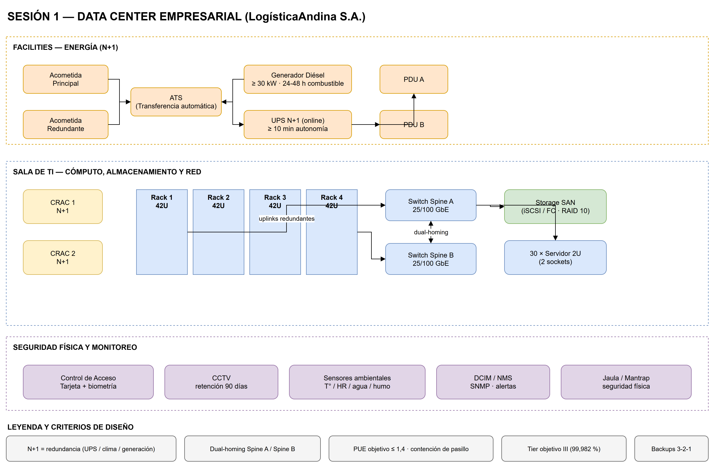
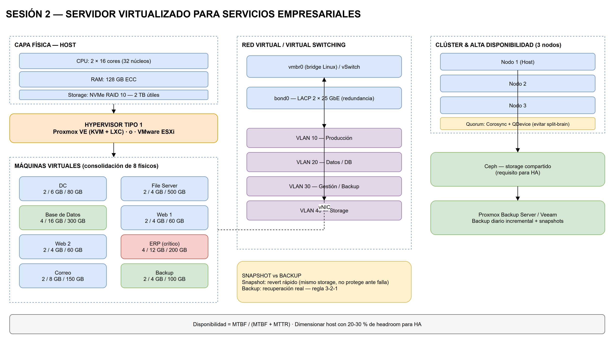
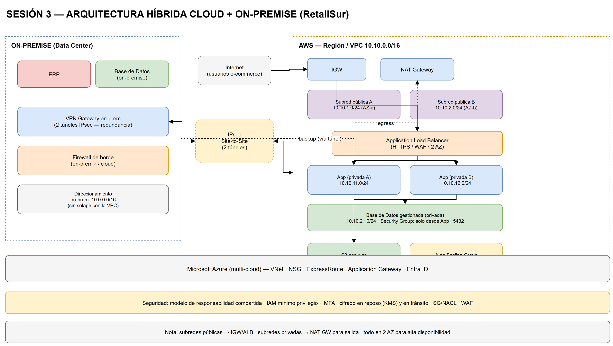
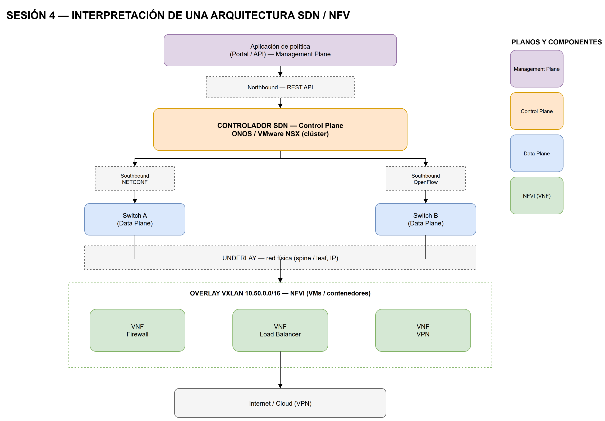
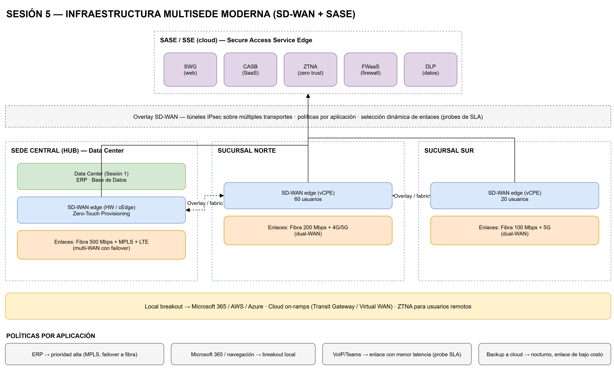

# Curso: Data Center, Cloud, Virtualización y Redes Definidas por Software

**Modalidad:** 5 sesiones virtuales · 20:00–22:00 (2 horas por sesión)
**Carga total:** 10 horas de clase + trabajo autónomo de práctica
**Idioma:** Español
**Nivel:** Profesional / Intermedio–Avanzado

---

## 1. Descripción del curso

Este curso entrega una visión **integral y aplicada** de la infraestructura moderna de TI,
recorriendo la cadena completa que va desde el piso físico de un Data Center hasta las redes
programables y la conectividad multisede segura.

El hilo conductor es simple: *cómo se diseñan, se virtualizan, se llevan a la nube y se
automatizan* los servicios de infraestructura de una empresa. Cada sesión combina teoría
sólida con una **práctica virtual** de diseño, de modo que el alumno termina con artefactos
concretos (diagramas, dimensionamientos, políticas) que puede reutilizar en su trabajo.

---

## 2. Objetivos generales

Al finalizar el curso, el participante será capaz de:

1. Diseñar conceptualmente un Data Center profesional considerando energía, redundancia,
   climatización, seguridad física y niveles Tier.
2. Dimensionar y diseñar infraestructura virtualizada con Proxmox VE y VMware, aplicando
   criterios de alta disponibilidad, backups y contenedores.
3. Proponer arquitecturas cloud e híbridas sobre AWS y Azure, dominando redes (VPC/VNet),
   subredes, gateways, balanceadores y conectividad on-premise.
4. Interpretar y explicar arquitecturas SDN y NFV, entendiendo planos de control/datos,
   controladores, APIs y automatización.
5. Diseñar una infraestructura multisede moderna con SD-WAN, SASE, ZTNA y microsegmentación.

---

## 3. Público objetivo y prerequisitos

- Administradores de sistemas y redes, ingenieros de infraestructura, arquitectos de TI,
  técnicos de soporte que quieran escalar a diseño.
- **Prerequisitos deseables:** fundamentos de redes (TCP/IP, VLAN, routing), noción de
  sistemas operativos (preferentemente Linux), y manejo básico de consola.
- No se requiere experiencia previa en cloud ni en virtualización.

---

## 4. Metodología

| Elemento | Descripción |
| --- | --- |
| Teoría guiada | Exposición con diagramas, ejemplos reales y analogías de arquitectura. |
| Práctica virtual | Ejercicio de diseño por sesión (draw.io, Proxmox, AWS/Azure, Docker). |
| Ejercicios | Problemas de cálculo y de decisión técnica con solucionario. |
| Autoevaluación | Quiz de cierre por sesión. |
| Herramientas | Draw.io, Proxmox VE, VMware, Docker, AWS, Azure, Google Cloud, distros Linux deb/rpm. |

> Las **herramientas sugeridas son no limitativas**: cada práctica puede resolverse con
> alternativas equivalentes siempre que se justifiquen las decisiones técnicas.

---

## 5. Estructura de cada sesión (2 horas)

Cada archivo de sesión sigue la misma plantilla:

```
1. Información general y objetivos
2. Contenido teórico (por subtema)
3. Práctica virtual guiada (paso a paso)
4. Ejercicios propuestos
5. Solucionario
6. Recursos y lecturas sugeridas
7. Autoevaluación (quiz)
8. Glosario de la sesión
```

Distribución típica del tiempo:

- **Bloque 1 — Teoría (60 min):** conceptos, arquitecturas y criterios de diseño.
- **Bloque 2 — Práctica guiada (40 min):** desarrollo del ejercicio de diseño.
- **Bloque 3 — Cierre y autoevaluación (20 min):** puesta en común, quiz y preguntas.

---

## 6. Programa de sesiones

| # | Sesión | Foco | Práctica virtual |
| --- | --- | --- | --- |
| 1 | [Data Center Profesional](sesion-01-data-center.md) | Diseño, energía, redundancia y alta disponibilidad | Diseño conceptual de un Data Center empresarial |
| 2 | [Virtualización con Proxmox y VMware](sesion-02-virtualizacion-proxmox-vmware.md) | Hypervisores, VMs, clústeres, HA y Docker | Diseño de un servidor virtualizado empresarial |
| 3 | [Cloud Networking: AWS y Azure](sesion-03-cloud-networking-aws-azure.md) | IaaS/PaaS/SaaS, VPC/VNet y arquitecturas híbridas | Diseño de una arquitectura híbrida Cloud + On-Premise |
| 4 | [SDN, NFV y Redes Programables](sesion-04-sdn-nfv-redes-programables.md) | Planos, controladores, APIs y automatización | Interpretación de una arquitectura SDN/NFV |
| 5 | [SD-WAN, SASE y Conectividad Multisede](sesion-05-sdwan-sase-multisede.md) | SD-WAN, SASE, ZTNA y microsegmentación | Diseño de una infraestructura multisede con capas gratuitas (free tier) |

---

## 7. Evaluación sugerida

| Instrumento | Peso | Momento |
| --- | --- | --- |
| Ejercicios por sesión (con solucionario) | 40 % | Al cierre de cada sesión |
| Práctica virtual (entregable de diseño) | 40 % | Al cierre de cada sesión |
| Autoevaluación / quiz | 20 % | Sesión final integradora |

Rúbrica genérica del entregable de práctica:

- **Completitud (25 %):** cubre todos los puntos solicitados.
- **Justificación técnica (25 %):** cada decisión está argumentada (redundancia, costos, riesgos).
- **Claridad del diagrama (25 %):** legible, rotulado, con leyenda.
- **Criterio profesional (25 %):** usa estándares (TIA-942, ASHRAE, Tier) y buenas prácticas.

---

## 8. Proyecto integrador (opcional)

Se sugiere encadenar las cinco prácticas en un único caso empresarial: una empresa mediana
con **dos sedes** que quiere modernizar su infraestructura paso a paso.

1. Sesión 1 → diseño del Data Center principal.
2. Sesión 2 → plataforma de virtualización del Data Center.
3. Sesión 3 → extensión híbrida a la nube (AWS/Azure).
4. Sesión 4 → lectura SDN/NFV de la red del Data Center.
5. Sesión 5 → unión de ambas sedes con SD-WAN/SASE.

El resultado final es un **dossier de arquitectura** coherente, listo para presentar.

> **Examen final integrador:** [`examen-final.md`](examen-final.md) — cubre las 5 sesiones
> (selección múltiple, V/F, cálculos y caso de diseño) con **solucionario y rúbrica**.

---

## 9. Diagramas de práctica (.drawio)

Cada práctica incluye un diagrama base editable en **draw.io / diagrams.net**
(`Archivo > Abrir` o arrastrar el `.drawio` al lienzo). Son un **punto de partida**:
el alumno debe completarlos, ajustarlos y justificar los cambios.

Cada diagrama se entrega en **3 formatos**: `.drawio` (editable), `.svg` (vectorial) y
`.png` (2× para embeber en documentos y presentaciones).

| Sesión | Archivo | Contenido del diagrama |
| --- | --- | --- |
| 1 | [`practicas/sesion-01-dc-empresarial.drawio`](practicas/sesion-01-dc-empresarial.drawio) | Energía N+1, sala de TI (racks, spine-leaf, SAN) y seguridad/monitoreo |
| 2 | [`practicas/sesion-02-servidor-virtualizado.drawio`](practicas/sesion-02-servidor-virtualizado.drawio) | Host físico, hypervisor, VMs, red virtual, clúster/HA, Ceph y backups |
| 3 | [`practicas/sesion-03-arquitectura-hibrida.drawio`](practicas/sesion-03-arquitectura-hibrida.drawio) | On-premise + VPC (AWS), VPN Site-to-Site, ALB, subredes y S3 |
| 4 | [`practicas/sesion-04-arquitectura-sdn-nfv.drawio`](practicas/sesion-04-arquitectura-sdn-nfv.drawio) | Planos management/control/data, controlador, overlay VXLAN y VNF |
| 5 | [`practicas/sesion-05-infra-multisede.drawio`](practicas/sesion-05-infra-multisede.drawio) | SASE/SSE, tres sedes, overlay SD-WAN, políticas y breakout local |

### Previsualización

| Sesión 1 — Data Center | Sesión 2 — Virtualización |
| --- | --- |
|  |  |
| **Sesión 3 — Nube híbrida** | **Sesión 4 — SDN/NFV** |
|  |  |

**Sesión 5 — Multisede (SD-WAN + SASE)**



---

## 10. Cómo usar estos archivos

- Léelos en orden: cada sesión asume los conceptos de la anterior.
- Los **ejercicios** están diseñados para resolverse *antes* de mirar el solucionario.
- Los bloques de código y diagramas ASCII son ilustrativos; en la práctica se trasladan a
  draw.io o a la herramienta real (Proxmox, AWS, Azure, Docker).
- Copia los plantillas de las prácticas como base de tus propios entregables.
